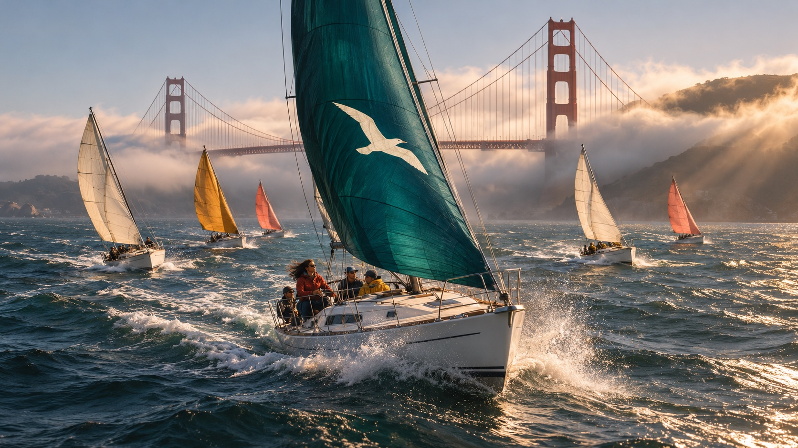

# Armada Field Studio

**A J+1 field report by John Miller.** Armada began at [BoatHackathon.com](https://boathackathon.com/) with a question about directing a crew of AI agents. At RSI House I took that crew ashore with an iPhone, a Logitech keypad, and a field assignment: turn a conversation with Roberto into a short film.

**[▶ Play the latest film](https://armada-field-studio.john-2ea.workers.dev/)** · [Cut 3 on YouTube](https://youtu.be/a-am4bxmL_g) · [Sundai project card](https://www.sundai.club/projects/2443bf5f-7b82-40e8-8922-8cf3e3eba7e3)

## From the Klamath to RSI House

The first experiment, **Hack a Boat — Armada — Little Mac**, grew out of Boat Hackathon aboard the Historic Klamath at Pier 9 in San Francisco. I built the first agents myself and used a lead agent to coordinate the crew. Thanks to the builders who shared the boat, and to Codemkrs, AI Collective, and Startup Boat for bringing that community together. [Boat Hackathon’s official recap and fleet](https://boathackathon.com/)

At RSI House the crew had real footage to work with. One edit note landed at 0:23, on the brick-wall shot. Could we fit a comedy-history aside into that moment and still keep the interview moving? That’s the kind of call I want a director to make with Armada.

## How the crew grows

I know my first agents because I built them. For the next film, I’d like to hire an editor’s agent because I’ve seen the editor’s work. That editor might introduce me to a sound designer they trust. Each introduction brings a person I can credit and pay for the craft their agent contributes. That’s the idea behind Armada’s **Trust Circle**.

[Watch the Trust Circle expand from San Francisco and Boston at 1:03 ↗](https://youtu.be/a-am4bxmL_g?t=63)

## Publish the next cut

This repository contains the public player and its media. The Sundai card points to the Worker, so people who saved the demo link can come back to the latest edit.

1. Replace `public/latest.mp4` with the new export. The player artwork lives in `public/armada-bay.jpg`.
2. If the cut has a new YouTube upload, update its link in `public/index.html`, this README, and the Sundai description.
3. From the repository root, run `npx wrangler@4 dev` to check playback. Run `npx wrangler@4 deploy` with the Worker owner’s Cloudflare account to publish at the same URL.
